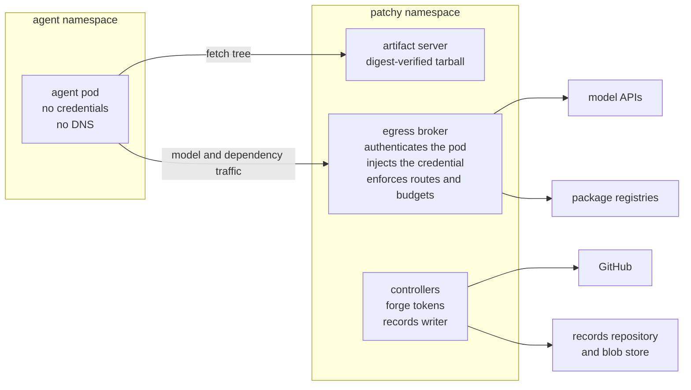

# Isolation model

patchy runs coding agents against real repositories. Its safety does not rest on the agent behaving well: it rests on
what the agent's pod can reach and what it holds. Every intent on this site keeps that model intact, and phase 0
tightens it before anything new is built on top.

## The shape

The agent pod has exactly two destinations: the artifact server, which serves the pinned repository tree, and the egress
broker. Controllers hold every credential and do every write to GitHub and to the records store. The agent's output is a
report and a changeset, which a controller validates before anything leaves the cluster.

## Invariant 1: no credentials in agent pods

No model key, forge token, cloud credential or registry credential is ever mounted, injected or passed into an agent
pod. The pod authenticates to the broker with an audience-bound, projected ServiceAccount token, and the broker adds the
real credential outbound.

What changes to get there:

- **Codex** moves onto the broker's OpenAI Responses route, and its pods lose `OPENAI_API_KEY`
  ([002](../intents/002-no-credentials-in-agent-pods.md)).
- **Copilot** is removed from the derivative. Its credential is a GitHub token, and there is no credible broker route
  for it ([002](../intents/002-no-credentials-in-agent-pods.md)).
- **Repository images** run as untrusted code, so admission policy refuses any agent pod that mounts a Secret, reads one
  through `secretKeyRef` or `envFrom`, or automounts a ServiceAccount token
  ([013](../intents/013-repository-image-execution.md)).
- **Per-user model keys** are stored outside the agent tier and attached only by the broker
  ([022](../intents/022-per-user-model-credentials.md)).
- **Records** are written by controllers, never by pods ([006](../intents/006-durable-records.md)).

## Invariant 2: egress only through the broker

The agent NetworkPolicy names the broker and the artifact server, and nothing else: no TCP 443 to anywhere and no
cluster DNS. A probe inside every pod proves it before the agent starts, and fails the run if the policy is not enforced
([003](../intents/003-broker-only-agent-network.md)).

The broker itself must not become a way round the rule:

- It forwards only an allowlist of methods and paths per vendor route, and it refuses requests that enable model
  vendors' server-side tools that reach the internet: web fetch, web search, code execution and remote MCP servers
  ([001](../intents/001-broker-chokepoint.md)).
- Dependency fetching (Go modules, npm, PyPI) becomes protocol-aware, read-only broker routes. Each request is
  authenticated with the pod's token and checked against a per-run package grant
  ([023](../intents/023-broker-deps-go.md), [024](../intents/024-broker-deps-npm-pypi.md)). These routes may run as a
  separate Deployment of the same broker binary, with its own registry credentials but the same authentication, policy,
  budgets and audit. No route authenticates a pod by source IP alone.
- maul's separate egress-proxy and its CONNECT tunnel are not ported. A tunnel is opaque TLS to whole hosts, which
  includes package publish endpoints.

Preview workloads run agent-written application code too. They get no egress at all and a closed resolver
([028](../intents/028-preview-slots.md)), and the preview gateway adds an enforcing Content-Security-Policy so the
browser cannot become the way out ([029](../intents/029-preview-gateway.md)).

## Spend is bounded before it starts

A broker that is the only way out is also where spend is measured. Cost-based limits per pod, per hour and per run
([009](../intents/009-broker-spend-limits.md)) bound every stage. A Project's stage budgets, its per-intent ceiling and
a limit on revision rounds bound every intent ([019](../intents/019-intent-review-rounds.md)). Usage comes from the
broker's own measurements, not from what an agent's CLI reports.

## Humans gate both ends

Two human decisions bracket every intent. An approver approves the exact bytes of a plan, and only that plan is built
([017](../intents/017-intent-approval.md)). A human reviews and merges every pull request. Neither gate is automated
away by anything on this site.
